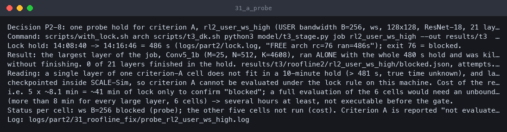

# AI chip design lab

An open-source, reproducible lab that takes a small AI accelerator from a multiply-accumulate unit to a laid-out chip using only open tools, run unattended on an old 2-core Intel MacBook with 8 GB of RAM (no Homebrew, no sudo; a Colima VM runs the containers). Three baseline checks establish objective truth (answers checked against math, a second independent tool, or published reference values); sweeps then explore the design space.

Open [`demo/index.html`](demo/index.html) for the full walk-through: concepts, tool map, how each result was tested, plots, and honest caveats.

## Status

Generated from the files in this repository by `python3 scripts/demo_build.py` (Total runtime: 5h 08m, from 2026-10-12 02:48:36 PDT to 07:57, budget 6h).

| Check | Status | Detail |
|---|---|---|
| Container runtime install | **PASS** | route A (Colima + Lima, macOS Virtualization.framework) |
| Lab images (lab-sim, ORFS) | **PASS** | both images referenced in coord/images.env |
| Task 1: INT8 systolic array vs NumPy | **PASS** | t1_summary.json: pass=true |
| Task 1: formal MAC proof (SBY) | **PASS** | checks: formal_bmc_pass=true, formal_prove_pass=true |
| Task 1: RTL = netlist equivalence (EQY) | **PASS** | checks: eqy_array_pass=true, eqy_mac_pass=true, eqy_pass=true; scope: split proof (1) mac_int8 incl. multiplier, (2) full 4x4 array with mac_int8 black-boxed; compared against the generic-gate Yosys netlist (synth; abc; opt), NOT the placed-and-routed nangate45 netlist (the ORFS logic-equivalence step is disabled, see caveats) |
| Task 2: OpenROAD gcd flows within ORFS's shipped regression thresholds | **PASS** | t2_summary.json: pass=true; NOT timing-closed: nangate45/gcd misses timing at its 0.25 ns reference clock (WNS -0.161583 ns, TNS -7.08646 ns, 51 violating endpoints); sky130hd/gcd misses timing at its 1.1 ns reference clock (WNS -1.45954 ns, TNS -64.9417 ns, 63 violating endpoints) |
| Task 3: SCALE-Sim vs analytical model | **FAIL** | FAIL: criteria that fail: calc_required_bw_inverse_to_ai_ws, calc_required_bw_inverse_to_ai_os, calc_required_bw_inverse_to_ai_is (criterion B, CALC mode: rho(intensity, required bandwidth) must be <= -0.6 for every dataflow). Criterion A (stalls at a fixed user bandwidth) is NOT EVALUATED (cost), neither pass nor fail: A_incomplete(ws_mid=not_run,ws_high=blocked,os_mid=not_run,os_high=not_run,is_mid=not_run,is_high=not_run); the probe showed the largest layer alone needs more than 481 s, over the 10-minute lock-hold rule (results/evidence/31_a_probe.txt). Open items: repro byte-identity of 3 result files. Pre-registered thresholds were not changed (model/t3_roofline2_criteria.json, P2-A1/P2-A2/P2-7); the Part 2 hypothesis was wrong in its mechanism (the bundled google.cfg already uses USER bandwidth and its stalls are all zero, results/evidence/31_original_stalls.txt). Explainer: docs/t3_roofline_explained.md |
| Sweep A: architecture (SCALE-Sim) | **DONE** | sweep stopped (marker .done); this is a completion status, not a pass/fail verdict; 165 ok of 264 planned points (1 error, 1 skipped after timeout, 97 never reached before the deadline) |
| Sweep B: physical (ORFS) | **DONE** | sweep stopped (marker .done); this is a completion status, not a pass/fail verdict; gcd closes at 0.42-0.425 ns depending on utilization (about zero margin at 0.42 ns, u50); systolic_os at 30 % utilization: closes at 1.25 ns (WNS 0.0132117 ns), fails at 1.2 ns (WNS -0.00730405 ns), 6 points; 1 failed point(s) |
| Repeatability rerun (repro) | **RUNNING** | summary says pass=true but a re-run is in progress; 10 of 10 checks identical in the Part 1 report (results/repro_report.json predates the Part 2 repro: its scope was Tasks 1 and 3 re-run once, Task 2 from its two original runs, systolic_os a single run). The Part 2 report with every design's run count (gcd 4 runs on both PDKs, systolic_os 3, from results/t2_reruns.json) replaces it when `make repro` finishes |
| Task 1: RTL = ROUTED netlist equivalence (EQY) | **PASS** | eqy_routed_pass = true in t1_summary.json; EQY partitions proved: 27 of 27 |
| Task 1: routed gate-level simulation vs NumPy | **PASS** | Pass on Icarus only; Verilator gate-level simulation not run (partial vs TASK2 P1.3 item 4); gls_routed_pass = true in t1_summary.json; Icarus 0 mismatches against NumPy: True; negative control detected: True; Verilator: not run: the verilator model build of the routed netlist did not finish within the lock hold (stopped after 544 s, exit code 124); no simulation result exists |
| Task 2: matches ORFS's published reference results | **PASS** | matches_published = true in t2_summary.json |
| Make recipes executed for real | **RUNNING** | 7 recipe(s) recorded in results/make_recipes.json; non-zero exit: t3 |

### What is not green yet, why, and the next action

State is computed from the files; diagnosis and next action are explanations written from the decisions in COORDINATION.md.

| Row | State now | Diagnosis | Next action |
|---|---|---|---|
| Task 3: SCALE-Sim vs analytical model | **FAIL** | FAIL on the pre-registered criterion B: in CALC mode the intensity versus required-bandwidth rank correlation does not reach -0.6 for ws, os or is (values in the row and section 6). Criterion A (stalls at a fixed user bandwidth) is NOT EVALUATED, neither pass nor fail: a probe showed the largest ResNet-18 layer alone needs more than 481 s, over the 10-minute lock-hold rule, and SCALE-Sim cannot checkpoint inside a layer. The original hypothesis (default bandwidth mode hides stalls) was wrong: the bundled config uses user bandwidth and its stalls are all zero. | Thresholds are final and were not retuned. To finish criterion A the owner can approve long holds (several hours of exclusive machine time) or a smaller layer set registered as a new amendment before running; criterion B's failure needs a diagnosis of the analytic intensity (see docs/t3_roofline_explained.md). |
| Sweep A: architecture (SCALE-Sim) | **DONE** | A completion status: points never reached before the sweep deadline (cut because sweeps run at low priority behind stage jobs in the one-job-at-a-time queue; cheapest points ran first). | `make sweeps` resumes where it stopped; each unreached point is accounted for in the sweep section of the page. |
| Sweep B: physical (ORFS) | **DONE** | A completion status. The systolic_os frontier at 30 % utilization is bracketed by a failing and a closing period (see the row); 40 and 50 % utilization points are listed with their state in section 12. | `make sweeps` (or `python3 sweeps/phys_sweep.py --plan part2`) runs the remaining planned points. |
| Repeatability rerun (repro) | **RUNNING** | The Part 2 repro (Task 1 in full, Task 3 cheap set, Task 2 from the extra clean runs) is still running or has not been summarised; the user-bandwidth Task 3 runs are not rerun because of their cost and are reported as such, never as identical. | `make repro`; results/repro_report.json then shows every check with its run count. |
| Task 1: routed gate-level simulation vs NumPy | **PASS** | PASS on Icarus only: the task also asks for Verilator if the cell models parse (they do). The Verilator model build of the routed netlist did not finish within the 10-minute lock hold, so no Verilator gate-level result exists; every check that needs one is listed as NOT EVALUATED, neither pass nor fail. This is partial against the task, not a pass of the full item. | Build the Verilator gate-level model in a bounded way (a smaller or pre-built model, or a longer hold approved by the owner), then `T1R_STEPS=gls scripts/t1_routed.sh`. Until then the page keeps saying Icarus only. |
| Make recipes executed for real | **RUNNING** | Each recipe is executed for real by the recorder in queue order; the ones still running or not run yet are listed in the note on the page. | `make all` (fail-soft, always builds the demo, exits non-zero naming failed stages). |

## Part 2: before and after

| Check | At the start of Part 2 | Now |
|---|---|---|
| Runtime | PASS | **PASS** |
| Images | PASS | **PASS** |
| Task 1: sim vs NumPy, SBY, EQY | PASS | **PASS** |
| Task 2: ORFS gcd within thresholds | PASS | **PASS** |
| Task 3: SCALE-Sim vs analytic | FAIL | **FAIL** |
| Sweep A | Incomplete | **DONE** |
| Sweep B | Coarse | **DONE** |
| Repro | PASS | **RUNNING** |
| Make recipes | Untested | **RUNNING** |

Part 2 elapsed so far (not finished): 6h 28m, from 2026-10-12 09:03:34 PDT to now, budget 14h (Part 1's total runtime stays as recorded in its own section)

Part 2 stage states:

| Stage | State |
|---|---|
| `31_roofline_fix` P1.1 Task 3 roofline check | FAIL |
| `32_make_recipes` P1.2 every make recipe run for real | RUNNING |
| `11_eqy_routed` P1.3 equivalence and gate-level simulation of the routed netlist | PASS |
| `51_repro_full` P1.4 complete determinism story | RUNNING |
| `21_orfs_crosscheck` P1.5 Task 2 against ORFS's published results | PASS |
| `41_sweeps_finish` P1.6 finish and refine the sweeps | INCOMPLETE |
| `60_power_activity` P2.1 activity-based power | PENDING |
| `61_pe_bf16` P2.2 bf16 processing element | PENDING |
| `62_pdk_compare` P2.3 systolic_os on sky130hd | PENDING |
| `63_sram_cacti` P2.4 SRAM modelling (CACTI) | PENDING |
| `64_roadmap` P2.5 roadmap | PENDING |


PASS means the stage's `.done` marker exists and its summary JSON says `"pass": true`. Anything unfinished is shown as PENDING/RUNNING/BLOCKED/UNKNOWN and not assumed.

## What is in it

| Path | What |
|---|---|
| `env.sh` | Puts the lab-local tools (colima, docker) on PATH and redirects all VM/Docker state into this directory. |
| `env.json` | Measured machine facts (CPU, RAM, macOS, free disk) captured at preflight. |
| `budget.json` | The time budget and its milestones; the build elapsed time is computed from it. |
| `versions.lock` | Every pinned version, git SHA, image digest, download URL and SHA256 the lab used. |
| `coord/images.env` | The two container images (lab-sim build, ORFS pinned by digest) that every script sources. |
| `COORDINATION.md` | How the agents divided the work: rules, decisions with evidence, requests between agents. |
| `docker/lab-sim/Dockerfile` | Recipe for the simulation image (OSS CAD Suite, Verible, Python venv). |
| `docker/requirements.lock` | Hash-locked Python dependencies installed in the lab-sim image (it lives under docker/, not at the repo root). |
| `rtl/mac_int8.sv` | The multiply-accumulate unit: signed INT8 x INT8 into an INT32 accumulator. |
| `rtl/systolic_os.sv` | R x C output-stationary systolic array built from MAC processing elements. |
| `tb/test_systolic.py` | cocotb testbench: random + directed cases checked against NumPy, with functional coverage. |
| `formal/` | SymbiYosys property proofs for the MAC (Task 1). |
| `eqy/` | Equivalence check: RTL versus the Yosys gate-level netlist (Task 1). |
| `orfs/designs/` | Design configs for the OpenROAD flow (gcd reference and the systolic_os stretch design). |
| `orfs/render.py` | KLayout batch script that turns a GDS layout into a PNG. |
| `model/` | analytic.py: the closed-form cycle/roofline model that SCALE-Sim is checked against (Task 3). |
| `arch/` | SCALE-Sim configs and topologies used in Task 3 and sweep A. |
| `sweeps/` | Sweep drivers: architecture (SCALE-Sim) and physical (ORFS clock x utilization). |
| `scripts/` | Entry points: with_lock.sh (one heavy job at a time), t1/t2/t3 runners, repro.sh, demo_build.py. |
| `results/t1_summary.json` | Task 1 verdict and measured values. |
| `results/t2_summary.json` | Task 2 verdict and PPA metrics. |
| `results/t3_summary.json` | Task 3 verdict and fit residuals. |
| `results/repro_report.json` | Per-check identical/different verdicts from the clean rerun. |
| `results/sweeps/` | One JSON line per sweep point, keyed by its parameters. |
| `results/evidence/` | Scrubbed real terminal output of each stage's key command; rendered to PNG for the README. |
| `results/.stages/` | Stage markers (.done/.failed/.blocked/.running) that this page reads for its status. |
| `demo/index.html` | This page, generated by scripts/demo_build.py from whatever exists on disk. |
| `demo/run_demo.sh` | The 5-minute re-run: Task 1 (200 cases, both simulators), formal proof, one SCALE-Sim run, ORFS check, and the Task 3 roofline criterion B recomputed from saved reports., plus the routed-netlist gate-level simulation on Icarus with 20 random + 29 directed cases (Verilator not run). |
| `demo/assets/` | Waveform, layout, plots and evidence PNGs referenced by this page. |
| `Makefile` | make preflight runtime images t1 t2 t3 sweeps repro demo all. |

## Reproduce

```sh
source env.sh                 # lab-local PATH; all VM/Docker state stays inside this directory
make preflight                # machine facts
make runtime images           # Colima VM + pinned images (digests in coord/images.env, versions.lock)
make t1                       # Task 1: RTL vs NumPy on 2 simulators, formal, equivalence (full run incl. BMC-20)
make t2                       # Task 2: gcd on nangate45 + sky130hd, twice from clean (about 35 min of ORFS)
make t2-stretch               # systolic_os through ORFS (about 30 min)
make t3                       # Task 3: SCALE-Sim vs analytic model + roofline (exits non-zero while the roofline criterion fails)
make sweeps                   # architecture + physical sweeps; they start no new point after the sweep deadline in budget.json
make repro                    # reruns Task 1 in full and the cheap Task 3 set clean and compares; Task 2 runs come from results/t2_reruns.json
make demo                     # plots + evidence PNGs + demo/index.html + this README
make all                      # fail-soft loop over the above, always builds the demo, exits non-zero listing failed stages
bash demo/run_demo.sh         # short cut (cached images, scratch output dir); needs the VM running
```

### Make recipes: what was actually run

Each recipe below was executed for real as `make <recipe>` from the repo root (recorded by `scripts/make_record.py`, raw data in `results/make_recipes.json`). Wall time includes waiting in the one-job-at-a-time queue of this machine; the time without that wait is shown separately.

| Recipe | Exit code | Wall time | of which queue wait | Run time | Started | Log |
|---|---|---|---|---|---|---|
| `make runtime` | 0 | 9 min 47 s | 9 min 41 s | 6 s | 09:17:53 | `logs/part2/32_make_recipes/runtime_091753.log` |
| `make images` | 0 | 53 min 59 s | 52 min 58 s | 1 min 01 s | 09:27:41 | `logs/part2/32_make_recipes/images_092741.log` |
| `make t1` | 0 | 82 min 16 s | 63 min 11 s | 19 min 05 s | 13:56:30 | `logs/part2/32_make_recipes/t1_135630.log` |
| `make t2` | 0 | 69 min 08 s | 60 min 01 s | 9 min 07 s | 10:27:19 | `logs/part2/32_make_recipes/t2_102719.log` |
| `make t2-stretch` | 0 | 38 min 12 s | 19 min 49 s | 18 min 23 s | 11:36:27 | `logs/part2/32_make_recipes/t2-stretch_113627.log` |
| `make t3` | 2 | 55 min 39 s | 31 min 05 s | 24 min 34 s | 13:10:40 | `logs/part2/32_make_recipes/t3_131040.log` |
| `make repro` | still running | – | – | – | 14:06:34 | `logs/part2/32_make_recipes/repro_140634.log` |
| `make demo` | not run yet | – | – | – | – | – |
| `make t1-routed` | 0 | 1 min 01 s | 10 s | 51 s | 15:18:53 | `logs/part2/32_make_recipes/t1-routed_151853.log` |

**Not run as a recipe yet:** `make repro`, `make demo`.
**Recipes that exited non-zero:** `make t3` (exit 2) — see the log of each.

Notes:

- `make t2`: one fresh clean ORFS run per reference design (run 4 for gcd on both platforms, after the two Part 1 runs and pnr's P1.4 rerun), compared against all earlier runs by scripts/t2_repro.sh
- `make t2-stretch`: systolic_os on nangate45, a further clean run compared against the earlier ones
- `make t3`: attempt 2 (P2-7): criterion-A user-bandwidth jobs not started (T3_USER_DEADLINE=1) because the first one made no progress in a 769 s hold; this attempt runs the cheap second pass (bundled x3, fit, 3 CALC) and the summary; earlier jobs kept Reclassified by finish time (the recipe renamed results/t3.partial to results/t3 at its end). Under this attempt the recipe executed the second-pass jobs bundled_ws/os/is, fit, rl2_calc_ws/os/is (in results/t3.rerun.tmp, removed by the script after the byte-identity compare) and the summary + plots; see the '== t3 pass 2 job' lines in the log. Verdict printed by the recipe: pass=False, state=A_incomplete (criterion A: ws_high in_progress, the other five cells not_run); criterion B (calc_required_bw_inverse_to_ai_ws/os/is) False.
- `make t1`: official 10,000-case run of the per-step-lock script (rtl GO 13:47, inputs final at commit aea7f62)
- `make t1-routed`: resume mode (Decision P2-7 item 2): partitions and steps proven earlier today by the identical commands are kept (listed); only the remaining steps execute. gls_verilator skipped as instructed by rtl (T1R_SKIP)
- earlier attempts of `make t3`: attempt started 12:17:29: exit 2 after 52 min 42 s — Stopped on purpose at 13:11 (loop killed, container of the current job killed): job rl2_user_ws_high held the lock 769 s (12:55:47-13:08:36, exit 75 'partial') without finishing a single layer (its layers/ dir is empty; log: 'parallel failed: BrokenProcessPool' for Conv5_1b/Conv5_2a) and had re-queued itself for an identical hold. Rule from main: no stage lock hold > 10 min. The three CALC jobs finished under this attempt (see executed_under_this_recipe). Next attempt runs with T3_USER_DEADLINE=1 (criterion-A user-bandwidth jobs not started) so the cheap second pass and the summary can complete; criterion A stays incomplete until arch fixes the job.

**`make all` fail-soft test:** not run yet.

## Evidence that it builds and runs

Terminal output saved by each stage, rendered to images from the saved text (not OS screenshots).





## Results


## Notes

- Versions, image digests, URLs and SHA256s: `versions.lock`, `coord/images.env`.
- VM end-state is stated at final packaging; start/stop commands are in `demo/README.md`.
- No personal paths, hostnames or credentials are stored in this repository; a pre-commit hook and `scripts/evidence_privacy.py` enforce that.

